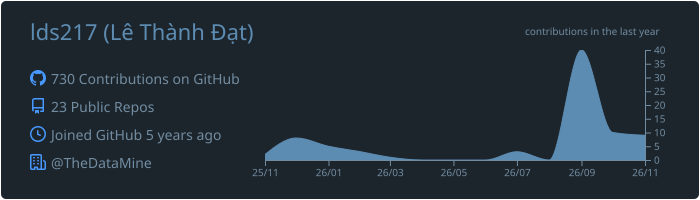
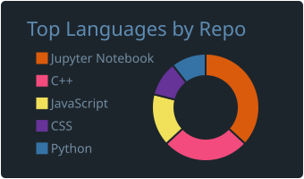
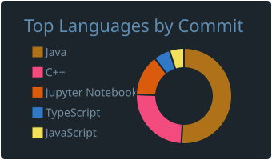
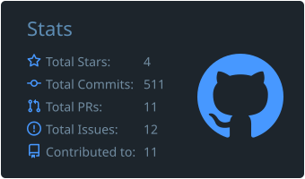
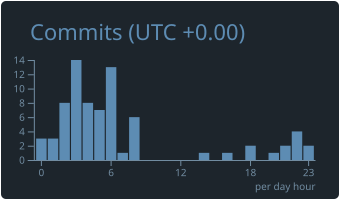

  

---

<table style="width:90%; max-width:900px; border-collapse:collapse;">
  <tr>
    <td style="width:45%; vertical-align:middle; padding-right:25px;">
      <h3>About me</h3>
      

        With over 4 years of experience in competitive programming, 
        I’ve developed strong data structures, algorithms, 
        and problem-solving skills that help me design 
        efficient and scalable systems.
      

      

        I’m passionate about backend development 
        and machine learning, 
        and I love building robust, data-driven solutions 
        that combine system performance 
        with intelligent automation.
      

    </td>
    <td style="width:55%; text-align:center;">
      
    </td>
  </tr>
</table>

---

Using <a href="https://github.com/vn7n24fzkq/github-profile-summary-cards">github-profile-summary-cards</a>

